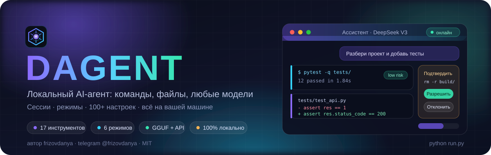

<div align="center">



**Локальный AI-агент с графическим интерфейсом.**
Подключает любую модель - API или `.gguf`, - выполняет команды, создаёт и правит файлы,
ведёт сессии и показывает каждое своё действие.

[Быстрый старт](#быстрый-старт) · [Модели](#подключение-модели) · [Режимы](#режимы) · [Интерфейс](#интерфейс) · [Безопасность](#безопасность) · [Тесты](#тесты) · [English](#english)

Автор: **frizovdanya** · Telegram [@frizovdanya](https://t.me/frizovdanya) · Лицензия MIT

</div>

---

## Что это

DAGENT - это агент, который живёт на вашем компьютере и работает руками: запускает команды, читает и создаёт файлы, ищет по проекту, ставит пакеты, пишет код, составляет отчёты. Вы пишете задачу на обычном языке - он разбивает её на шаги и выполняет, показывая в интерфейсе каждый шаг: терминал с выводом, diff правки, дерево файлов, план-чек-лист.

Модель можно подключить любую: OpenAI, DeepSeek, OpenRouter, Groq, Mistral, Anthropic, Qwen - или локальную через GGUF, LM Studio, Ollama, llama.cpp, vLLM. Моделей можно подключить несколько и переключаться между ними одной кнопкой.

Всё локально: свой веб-сервер, своя база сессий, свои настройки. Никакой телеметрии, никаких CDN, никакой сборки фронтенда - скачали, запустили, работает.

**Три шага до работы:** запустили → подключили модель → выбрали режим. Дальше просто пишете задачу.

---

## Возможности

* **17 инструментов**: команды оболочки, Python, чтение/запись/правка/удаление/перемещение файлов, поиск по содержимому и именам, дерево папки, загрузка веб-страниц, вопросы пользователю, память, живой план.
* **6 режимов**: Общение, Ассистент, Автопилот, Код, Терминал, Аналитик - каждый со своим набором инструментов и уровнем контроля.
* **Любые модели**: 18 готовых пресетов провайдеров, локальные серверы, нативный Anthropic и `.gguf` прямо в процессе (llama.cpp). Несколько профилей, мгновенное переключение.
* **Function calling и без него**: если модель не умеет инструменты - DAGENT передаст их текстом и сам разберёт JSON-ответ. Работает даже с маленькими локальными моделями.
* **Сессии**: история, поиск, закрепление, дублирование, экспорт в JSON и Markdown, сжатие длинной истории, «перегенерировать с этого места».
* **Контроль и безопасность**: песочница рабочей папки, защищённые пути, чёрный список команд, оценка риска каждого действия, подтверждения с превью (diff / команда / содержимое), таймаут авто-отказа, журнал действий.
* **100+ настроек** в 9 группах: поведение агента, параметры генерации, безопасность, рабочая папка, интерфейс, GGUF, горячие клавиши, чат, модели.
* **Интерфейс, который приятно использовать**: 7 тем, 8 акцентов, свой CSS, 3 плотности, светлая и тёмная схемы, фоновые эффекты, плавный стриминг, подсветка кода, Markdown, diff, карточки инструментов, командная палитра, горячие клавиши, RU/EN.
* **Мониторинг**: активность по шагам, план, изменённые файлы, встроенный терминал, контекст и расход токенов, журнал.
* **API и WebSocket** для всего - можно автоматизировать из скриптов и ботов.
* **Демо-режим без интернета и ключей**: `python scripts/demo.py` поднимает встроенную демо-модель, чтобы всё попробовать.

---

## Быстрый старт

Нужен только **Python 3.10+**.

### Linux / macOS

```bash
git clone https://github.com/frizovdanyash/DAGENT.git
cd DAGENT
bash scripts/install.sh      # виртуальное окружение + зависимости
bash scripts/start.sh        # откроет http://127.0.0.1:8420
```

### Windows

```bat
git clone https://github.com/frizovdanyash/DAGENT.git
cd DAGENT
scripts\install.bat
scripts\start.bat
```

### Вручную (любая система)

```bash
pip install -r requirements.txt
python run.py                       # http://127.0.0.1:8420
python run.py --port 9000           # другой порт
python run.py --workspace ~/project # сразу указать рабочую папку
python run.py --host 0.0.0.0        # доступ из локальной сети
```

### Попробовать без ключей и интернета

```bash
python scripts/demo.py
```

Поднимется встроенная демо-модель, рабочая папка наполнится примерами файлов, профиль «Демо-модель (офлайн)» активируется сам - можно сразу писать задачи и смотреть, как агент вызывает инструменты.

### При первом запуске

Откроется короткий мастер: **язык → модель → режим и рабочая папка → готово**. Модель можно пропустить и подключить позже. Дальше всё в интерфейсе: `Ctrl+,` - настройки, `Ctrl+K` - командная палитра, `Ctrl+M` - смена модели.

---

## Подключение модели

**Настройки → Модели → «Подключить модель»** (или мастер при первом запуске). Три пути:

| Путь | Как | Пример |
| --- | --- | --- |
| **API-провайдер** | выбрать пресет, вставить ключ, нажать «Проверить» | DeepSeek, OpenAI, OpenRouter, Groq, Mistral, xAI, Qwen, Together, Fireworks, Moonshot, SiliconFlow |
| **Локальный сервер** | запустить LM Studio / Ollama / llama.cpp / vLLM и подключить как API | `http://localhost:1234/v1`, `http://localhost:11434/v1` |
| **Файл `.gguf`** | `pip install llama-cpp-python`, найти файл в настройках - и готово | Qwen2.5-Coder-7B-Q4_K_M.gguf |

Готовые пресеты: `openai`, `anthropic_proxy`, `openrouter`, `deepseek`, `groq`, `mistral`, `together`, `fireworks`, `xai`, `moonshot`, `qwen`, `siliconflow`, `lmstudio`, `ollama`, `llamacpp`, `vllm`, `koboldcpp`, `custom`.

Нативный Anthropic API - отдельный тип профиля (`kind: anthropic`).

Кнопка «Проверить соединение» отправляет короткий запрос и показывает задержку; «Получить список моделей» подтянет реальные имена моделей с сервера. Моделей можно добавить сколько угодно - у каждой свои параметры генерации, контекст, цвет и заметки.

Подробнее, включая параметры llama.cpp и решение типовых проблем: **[docs/MODELS.md](docs/MODELS.md)**.

---

## Режимы

| Режим | Инструментов | Подтверждения | Итераций | Для чего |
| --- | --- | --- | --- | --- |
| **Общение** `chat` | 0 | - | 1 | Просто разговор, без доступа к системе |
| **Ассистент** `assistant` | 17 | на каждое действие | 12 | Повседневная работа под вашим контролем |
| **Автопилот** `autopilot` | 16 | не нужны | 30 | Длинная задача без остановок |
| **Код** `code` | 16 | да | 25 | Разработка: анализ проекта, правки, тесты, git |
| **Терминал** `terminal` | 16 | да | 20 | Установка, диагностика, пакетные команды |
| **Аналитик** `analyst` | 8 | не нужны | 15 | Только чтение: исследование и отчёты |

Режим выбирается на каждую задачу - в поле ввода или через `Ctrl+K`. Свой режим добавляется одним запросом к API.

**Инструменты:** `run_command`, `python_run`, `read_file`, `write_file`, `edit_file`, `delete_path`, `create_dir`, `move_path`, `copy_path`, `list_dir`, `file_info`, `search_files`, `workspace_tree`, `web_fetch`, `ask_user`, `remember`, `update_plan`.

Полное описание каждого инструмента, параметров и типов карточек: **[docs/TOOLS.md](docs/TOOLS.md)**.

---

## Интерфейс

Три панели, которые можно скрывать:

* **Слева** - сессии с поиском, закреплением и метаданными; список моделей; рабочая папка.
* **В центре** - чат: сообщения с Markdown и подсветкой кода, карточки инструментов (терминал с живым выводом, diff, дерево, поиск, план, вопрос), статус выполнения, шкала контекста.
* **Справа** - мониторинг: активность по шагам, план задачи, изменённые файлы, встроенный терминал, сведения о системе и журнал.

Внизу - поле ввода: вложения, выбор режима, выбор модели, отправка.

**Оформление.** 7 тем (`midnight`, `obsidian`, `nebula`, `forest`, `nord`, `daylight`, `paper`), 8 акцентных цветов + свой HEX, свой CSS поверх темы, 3 плотности, настройка шрифтов и размеров, скругления, ширина колонки, фоновые эффекты (аврора / сетка / звёзды), размытие панелей, анимации. Всё применяется мгновенно и без перезагрузки.

**Горячие клавиши** (все переназначаются в настройках):

| Действие | Клавиши | Действие | Клавиши |
| --- | --- | --- | --- |
| Отправить | `Enter` | Новая сессия | `Ctrl+N` |
| Перенос строки | `Shift+Enter` | Сменить модель | `Ctrl+M` |
| Палитра команд | `Ctrl+K` | Остановить выполнение | `Ctrl+.` |
| Настройки | `Ctrl+,` | Фокус в поле ввода | `Ctrl+L` |
| Поиск по сессиям | `Ctrl+F` | Перегенерировать | `Ctrl+R` |
| Скрыть левую панель | `Ctrl+B` | Скрыть мониторинг | `Ctrl+J` |

Языки интерфейса: русский и английский (переключаются на лету, включая названия режимов и подсказки).

---

## Безопасность

DAGENT действительно выполняет команды, поэтому защита многослойная - и слои не отключаются вместе с автопилотом:

1. **Песочница**: все пути живут внутри рабочей папки, символьные ссылки наружу разрешаются и блокируются.
2. **Защищённые пути**: `/etc`, `/root`, `/proc`, `~/.ssh`, `~/.aws`, `~/.gnupg`, `C:\Windows` - закрыты всегда.
3. **Чёрный список команд**: `rm -rf /`, форк-бомба, `mkfs`, `dd` в устройство, `shutdown`, `curl ... | sh`, `git push --force main` - не выполняются вовсе.
4. **Оценка риска**: каждое действие получает метку `low` / `medium` / `high` / `blocked` и объяснение - видно прямо в карточке.
5. **Подтверждения с превью**: перед правкой показывается diff, перед записью - содержимое, перед командой - её полный текст. Можно разрешить «только сейчас», «этот инструмент в сессии», «эту команду», «эту папку».
6. **Таймаут**: не ответили за `security.confirm_timeout` (300 с) - действие отклоняется, агент продолжает работу.
7. **Отдельные выключатели**: удаление, `web_fetch`, `python_run`, запись вне папки, чтение вне папки.
8. **Журнал**: все подтверждения, отказы и блокировки пишутся в базу и в `~/.dagent/logs/audit.log`.
9. **Защита локального API**: сервер на `127.0.0.1`, случайно сгенерированный токен, проверка `Origin`, API-ключи моделей маскируются и не отдаются в браузер.

Подробности, настройки и практические рекомендации: **[docs/SECURITY.md](docs/SECURITY.md)**.

---

## Настройки

**117 настроек в 9 группах** - всё в окне `Ctrl+,` или в `~/.dagent/settings.json`:

| Группа | Что внутри |
| --- | --- |
| `app` | язык, адрес и порт, автооткрытие браузера, режим разработчика, токен, разрешённые Origin |
| `ui` | тема, акцент, свой CSS, шрифты, плотность, фон, размытие, анимации, поведение чата |
| `workspace` | рабочая папка, песочница, чтение снаружи, скрытые папки, недавние |
| `agent` | режим, итерации, температура, top_p/top_k, max_tokens, контекст, промпты, память, сжатие истории, протокол инструментов |
| `security` | подтверждения, таймауты, оболочка, чёрный и белый списки команд, защищённые пути, лимиты вывода и размеров файлов, журнал |
| `models` | профили моделей, активная модель, маскирование ключей |
| `gguf` | контекст, слои на GPU, потоки, батч, формат чата, mmap/mlock |
| `hotkeys` | все 12 сочетаний клавиш |
| `chat` | вложения, прокрутка при стриминге, отправка по Enter |

Настройки можно экспортировать, импортировать и сбросить (с сохранением моделей). Каждое изменение применяется сразу и сохраняется автоматически.

Полный список с описаниями и значениями по умолчанию: **[docs/SETTINGS.md](docs/SETTINGS.md)**.

---

## Автоматизация и API

Всё, что делает интерфейс, доступно по HTTP и WebSocket - можно управлять агентом из скриптов, ботов и других программ.

```bash
TOKEN=$(python run.py --print-token)

# запустить задачу
curl -s -X POST http://127.0.0.1:8420/api/chat \
  -H "X-DAGENT-Token: $TOKEN" -H "Content-Type: application/json" \
  -d '{"text": "Покажи структуру проекта и найди все TODO", "mode": "analyst"}'

# собрать события выполнения
curl -s -H "X-DAGENT-Token: $TOKEN" \
  "http://127.0.0.1:8420/api/runs/<run_id>/events?since=0&wait=15"
```

Есть и WebSocket `/ws` со всеми событиями в реальном времени: токены, статусы, вызовы инструментов, план, подтверждения, окончание выполнения.

Полный справочник эндпоинтов, тел запросов и событий: **[docs/API.md](docs/API.md)**.

---

## Тесты

Три независимых набора, все работают офлайн:

```bash
python tests/test_agent_flow.py        # 118 проверок бэкенда (in-process ASGI + демо-модель)
python tests/test_websocket.py         # 28 проверок живого сервера и WebSocket
npm install && node tests/test_frontend.mjs   # 87 проверок интерфейса (jsdom)
```

```
PASSED 118   FAILED 0
PASSED  28   FAILED 0
PASSED  87   FAILED 0
```

Фикстуры для интерфейсных тестов снимаются с настоящего бэкенда: `python tests/capture_fixtures.py`.

Архитектура, структура кода, соглашения и отладка: **[docs/DEVELOPMENT.md](docs/DEVELOPMENT.md)**.

---

## Где что лежит

| Путь | Что |
| --- | --- |
| `~/.dagent/settings.json` | все настройки и профили моделей |
| `~/.dagent/data/sessions.db` | сессии, сообщения, журнал действий |
| `~/.dagent/logs/audit.log` | журнал подтверждений и блокировок |
| `~/DAGENTWorkspace` | рабочая папка агента (можно сменить) |

Удалите эти файлы при выключенном DAGENT - и получите чистую установку.

---

## Требования

* Python 3.10 или новее
* `fastapi`, `uvicorn[standard]`, `httpx`, `python-multipart` (ставит `scripts/install.sh`)
* для `.gguf` внутри процесса - `llama-cpp-python` и компилятор C++ (не обязательно: локальные модели работают и через LM Studio / Ollama / llama.cpp server)
* для интерфейсных тестов - Node.js и `jsdom` (только разработка)

---

## Документация

* **[docs/MODELS.md](docs/MODELS.md)** - подключение API, локальных серверов и GGUF, параметры llama.cpp, решение проблем
* **[docs/TOOLS.md](docs/TOOLS.md)** - все инструменты и режимы
* **[docs/SETTINGS.md](docs/SETTINGS.md)** - справочник по 117 настройкам
* **[docs/SECURITY.md](docs/SECURITY.md)** - модель безопасности
* **[docs/API.md](docs/API.md)** - REST и WebSocket
* **[docs/DEVELOPMENT.md](docs/DEVELOPMENT.md)** - архитектура, тесты, вклад в проект

---

## Лицензия и автор

MIT © 2026 **frizovdanya**

Telegram: [@frizovdanya](https://t.me/frizovdanya)

Если проект пригодился - звезда на GitHub будет лучшей благодарностью. Вопросы, идеи и баги - в [Issues](https://github.com/frizovdanyash/DAGENT/issues) или в Telegram.

---
---

<div align="center">

## English

**DAGENT - a local AI agent with a graphical interface.**
Connect any model (API or `.gguf`), let it run commands, create and edit files,
keep sessions and watch every step it takes.

</div>

### What it is

DAGENT runs on your machine and works with its hands: it executes shell commands, reads and writes files, searches your project, installs packages, writes code, builds reports. You describe a task in plain language; it breaks the task into steps and shows each one in the UI - a live terminal, a diff of the edit, a file tree, a checklist plan.

Any model works: OpenAI, DeepSeek, OpenRouter, Groq, Mistral, Anthropic, Qwen - or local models via GGUF, LM Studio, Ollama, llama.cpp, vLLM. Add as many profiles as you like and switch between them with one keystroke.

Everything is local: own web server, own session database, own settings file. No telemetry, no CDN, no front-end build step.

**Three steps to work:** launch → connect a model → pick a mode.

### Highlights

* **17 tools**: shell commands, Python, read/write/edit/delete/move/copy files, content and filename search, workspace tree, web fetch, ask-the-user, memory, live plan.
* **6 modes**: Chat, Assistant, Autopilot, Code, Terminal, Analyst - each with its own toolset and approval policy.
* **Any provider**: 18 presets, local OpenAI-compatible servers, native Anthropic, in-process `.gguf` via llama.cpp.
* **Function calling or not**: models without tool support get a text protocol and their JSON answers are parsed for them.
* **Sessions**: history, search, pinning, duplicates, JSON/Markdown export, history compression, regenerate from a message.
* **Safety**: workspace sandbox, protected paths, blocked-command patterns, per-action risk rating, approvals with previews (diff / command / file content), auto-deny timeout, audit log.
* **117 settings** in 9 groups, live-applied and exportable.
* **A UI worth looking at**: 7 themes, 8 accents, custom CSS, 3 densities, light and dark, background effects, smooth streaming, code highlighting, Markdown, diffs, tool cards, command palette, hotkeys, RU/EN.
* **Monitoring panel**: step activity, plan, changed files, built-in terminal, context and token meter, audit log.
* **Full REST + WebSocket API** for scripting and bots.
* **Offline demo** with a built-in model: `python scripts/demo.py`.

### Quick start

Requires **Python 3.10+**.

```bash
git clone https://github.com/frizovdanyash/DAGENT.git
cd DAGENT

# Linux / macOS
bash scripts/install.sh && bash scripts/start.sh

# Windows
scripts\install.bat && scripts\start.bat

# or manually, anywhere
pip install -r requirements.txt
python run.py            # http://127.0.0.1:8420
```

Try it with no keys and no internet:

```bash
python scripts/demo.py   # built-in offline demo model + sample workspace
```

On first launch a short wizard asks for language, model, mode and workspace - the model step can be skipped and done later.

### Connecting a model

`Settings → Models → Connect a model`:

| Option | How |
| --- | --- |
| **Cloud API** | pick a preset, paste the key, press *Test* |
| **Local server** | run LM Studio / Ollama / llama.cpp / vLLM, connect it as an API (`http://localhost:1234/v1`) |
| **`.gguf` file** | `pip install llama-cpp-python`, then pick the file in Settings → Models → Local GGUF |

Presets: `openai`, `anthropic_proxy`, `openrouter`, `deepseek`, `groq`, `mistral`, `together`, `fireworks`, `xai`, `moonshot`, `qwen`, `siliconflow`, `lmstudio`, `ollama`, `llamacpp`, `vllm`, `koboldcpp`, `custom`. Details and troubleshooting: **[docs/MODELS.md](docs/MODELS.md)**.

### Modes

| Mode | Tools | Approvals | Iterations | Use it for |
| --- | --- | --- | --- | --- |
| `chat` | 0 | - | 1 | Pure conversation, no system access |
| `assistant` | 17 | every action | 12 | Everyday work under your control |
| `autopilot` | 16 | none | 30 | Long tasks without pauses |
| `code` | 16 | yes | 25 | Development: analysis, edits, tests, git |
| `terminal` | 16 | yes | 20 | Installs, diagnostics, batch commands |
| `analyst` | 8 | none | 15 | Read-only research and reports |

### Safety in one paragraph

The agent is sandboxed to the workspace folder (symlink escapes resolved and blocked), system and credential paths are always protected, destructive command patterns are blocked outright, every action gets a risk rating, risky actions wait for your approval with a preview (diff for edits, full text for commands), unanswered approvals auto-deny after a timeout, and every decision is written to an audit log. The local server binds to `127.0.0.1`, requires a generated token and validates `Origin`; model API keys are masked and never sent to the browser. Full details: **[docs/SECURITY.md](docs/SECURITY.md)**.

### Tests

```bash
python tests/test_agent_flow.py                 # 118 backend checks (in-process ASGI)
python tests/test_websocket.py                  # 28 checks against a real server + WebSocket
npm install && node tests/test_frontend.mjs     # 87 UI checks (jsdom)
```

### Docs

[MODELS](docs/MODELS.md) · [TOOLS](docs/TOOLS.md) · [SETTINGS](docs/SETTINGS.md) · [SECURITY](docs/SECURITY.md) · [API](docs/API.md) · [DEVELOPMENT](docs/DEVELOPMENT.md)

### License & author

MIT © 2026 **frizovdanya** · Telegram [@frizovdanya](https://t.me/frizovdanya)
